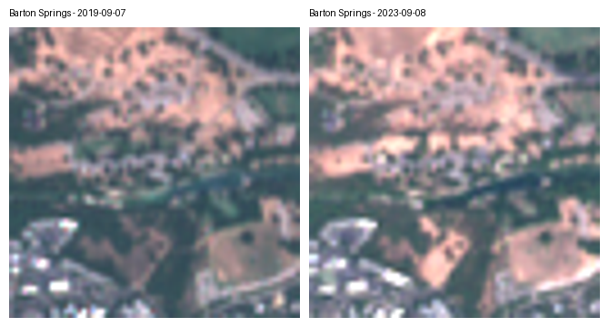
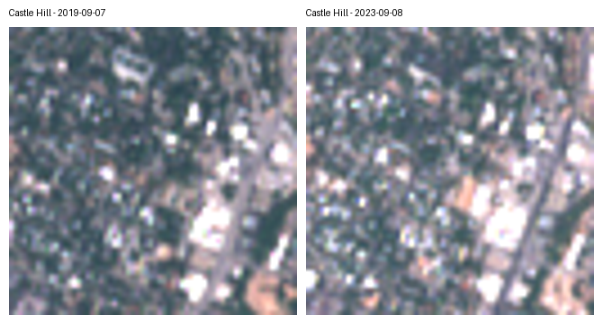
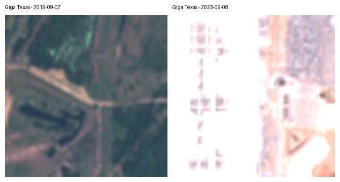

# Satellite Terrain Search & Change Detection

Self-supervised engine that (1) retrieves visually similar terrain from
Sentinel-2 imagery and (2) flags land-cover change at a location over time,
without any labelled training data.

* **Encoder:** ResNet-18 trained with a SeCo-style objective (Mañas et al.,
  ICCV 2021): MoCo-v2 contrastive learning where the positive pair is the
  *same location on different dates*, so features become invariant to season
  and atmosphere but still discriminate between places.
* **Data:** multi-date 64x64 RGB tiles at 10 m/px fetched on demand from
  Sentinel-2 L2A on Microsoft Planetary Computer (no account needed), sampled
  at random locations across Europe, 2019–2023.
* **Search:** FAISS inner-product index over L2-normalised embeddings, served by
  FastAPI.
* **Change detection:** embedding drift between two dates of the same place,
  with a threshold calibrated on the drift that ordinary seasonal variation
  produces. The served detector uses *spatial* drift (cosine distance between
  layer-3 feature maps, averaged over the 10% most-changed cells), which
  catches small localised changes that a single pooled embedding averages
  away. Catalogue-wide ranking additionally requires the change to *persist*
  (min drift over {2 earliest} x {2 latest} acquisitions), which suppresses
  transient clouds, snow and shadows that the Sentinel-2 cloud mask misses.

### Live check: Austin, Texas

The encoder and catalogue are Europe-only, but `/change/live` accepts any
coordinates, so we pointed it at three well-known Austin places, all Sep 2019
vs Sep 2023, using the same detector (threshold 0.675 spatial drift,
calibrated on European data):

* **Castle Hill** (1111 W 11th St) and **Tesla Gigafactory Texas** are popular
  Austin sites that have changed a bit over time, so we expect the detector to
  see some of that.
* **Barton Springs** is there to ask the opposite question: is the beautiful
  nature of Austin preserved over time?

| Site | Query | Spatial drift | z | Changed? | Nearest catalogue tiles |
|---|---|---|---|---|---|
| Barton Springs | `lat=30.2641&lon=-97.7713` | 0.187 | -0.99 | no | EuroSAT Industrial / Residential (sim ~0.87-0.89) |
| Castle Hill | `lat=30.2766&lon=-97.753731` | 0.211 | -0.80 | no | EuroSAT Residential (sim ~0.96) |
| Tesla Gigafactory Texas | `lat=30.2222&lon=-97.6170` | **0.789** | **3.62** | **yes** | EuroSAT Industrial (sim 0.80) |







**What it shows.** Barton Springs reads as unchanged: the creek corridor and
green space look the same in 2019 and 2023, so by this measure that piece of
Austin's natural beauty has been preserved. Castle Hill also reads as
unchanged at this resolution; its changes are too small for a 10 m/px tile.
Giga Texas is flagged clearly (global drift 0.587 also flagged): bare ground and
scrub in 2019 become a large bright-roofed factory by 2023 (construction began
2020). The 2023 tile looks washed out because that roof is very bright; it is
real structure, not cloud.

*Caveats: a 64x64 tile at 10 m/px covers ~640 m, so landmarks are not resolved
individually; the drift threshold was calibrated on European seasonality, and
the unchanged results are negatives, not evidence of Texas-level accuracy.
Similarity to catalogue tiles is to European / EuroSAT imagery, so it
indicates land-cover type, not a local match. Giga Texas coordinates are
approximate. Query times: ~19 s, ~8 s, ~14 s.*

## Results (measured, this repo)

### Terrain retrieval - EuroSAT test split (5400 queries vs 21600 indexed)

| Encoder (ResNet-18, 128 px input) | precision@10 | precision@1 |
|---|---|---|
| ImageNet-pretrained baseline | 84.7% | 88.2% |
| SeCo-style temporal contrastive (ours, 3 seeds) | **89.4% ± 0.3** | 91.6% ± 0.1 |

Per-class precision@10 (seed 0):

| Class | ImageNet | SeCo |
|---|---|---|
| AnnualCrop | 85.0 | 93.0 |
| Forest | 96.5 | 97.1 |
| HerbaceousVegetation | 82.1 | 82.2 |
| Highway | 63.2 | 76.6 |
| Industrial | 91.0 | 95.4 |
| Pasture | 86.2 | 88.8 |
| PermanentCrop | 84.4 | 79.7 |
| Residential | 91.8 | 96.6 |
| River | 69.8 | 78.6 |
| SeaLake | 92.3 | 98.6 |

### Change detection

OSCD: 1466 changed (>=5% px) / 136 heavily changed (>=30% px) / 3796 unchanged tiles. Seasonal null: 6000 held-out same-place/different-date pairs. Thresholds = 99% quantile of each detector's score on 23892 calibration pairs.

| Detector | OSCD AUROC (>=5%) | OSCD AUROC (>=30%) | Change vs. season AUROC | Recall (>=30%) @ thr | False alarms, seasonal | False alarms, OSCD unchanged |
|---|---|---|---|---|---|---|
| Pixel difference | 0.682 | 0.812 | 0.688 | 0.7% | 1.2% | 0.0% |
| ImageNet, global drift | 0.601 | 0.758 | 0.487 | 0.0% | 1.0% | 0.0% |
| ImageNet, spatial drift | 0.755 | 0.912 | 0.760 | 10.3% | 0.9% | 0.0% |
| SeCo, global drift | 0.603 | 0.821 | 0.809 | 8.1% | 1.1% | 1.3% |
| **SeCo, spatial drift (served)** | 0.742 | 0.912 | 0.877 | 6.6% | 0.7% | 0.2% |

Operating points (threshold = quantile of the seasonal null; recall on OSCD tiles with >=30% changed pixels / false alarms on held-out seasonal pairs):

| Detector | 99% quantile: recall / false alarms | 95% quantile: recall / false alarms |
|---|---|---|
| Pixel difference | 0.7% / 1.2% | 2.9% / 5.1% |
| ImageNet, global drift | 0.0% / 1.0% | 2.2% / 5.4% |
| ImageNet, spatial drift | 10.3% / 0.9% | 22.8% / 5.3% |
| SeCo, global drift | 8.1% / 1.1% | 24.3% / 5.4% |
| **SeCo, spatial drift (served)** | 6.6% / 0.7% | 33.8% / 5.4% |

### How to read these numbers

* Retrieval: both encoders are evaluated identically (same 128 px input,
  same index/query split). The SeCo encoder starts from the same ImageNet
  weights, so the gain comes from the temporal contrastive pretraining.
  Checkpoints are selected on a validation split carved from EuroSAT *train*;
  the test split is touched once per run.
* OSCD changes are mostly small urban edits; a 64x64 tile with 5% changed
  pixels is a hard case for any tile-level detector, which is why the pixel
  baseline and global drift sit near 0.6-0.7 AUROC there.
* "Change vs. season" is the operational question: can the detector tell real
  change (OSCD tiles with >=30% changed pixels) from the same place seen in a
  different season? Pixel differencing is close to useless here; SeCo
  training is what moves this number.
* Thresholds are calibrated without any change labels. At the 99% quantile
  (≈1% false alarms on unchanged land) recall on OSCD is low; the 95% quantile
  trades more false alarms for substantially more recall. Pick the operating
  point for the application.

## Inspiration and sources

This project came out of looking at Google's satellite embedding work and
asking whether a smaller, locally runnable version could be built and
evaluated honestly. The research behind it:

| Source | Connection to this project |
| --- | --- |
| [SeCo - Mañas et al., ICCV 2021](https://arxiv.org/abs/2103.16607) | The clearest technical source: learning from unlabelled satellite images of the same location across different dates, using seasonal variation to learn useful representations. The paper's affiliations are Element AI and Universitat Politècnica de Catalunya. |
| [Google DeepMind's AlphaEarth Foundations](https://deepmind.google/blog/alphaearth-foundations-helps-map-our-planet-in-unprecedented-detail/) | A strong conceptual parallel: represent Earth's surface as numerical embeddings. Google explicitly describes similarity search and change detection as applications of its [Satellite Embedding dataset](https://developers.google.com/earth-engine/tutorials/community/satellite-embedding-01-introduction). |
| [Google's Custom Satellite Embeddings](https://developers.google.com/maps/documentation/custom-satellite-embeddings) | A particularly close product parallel: embeddings for selected regions and time periods, supporting monitoring and change detection. |

In short, this project combines SeCo-style training with a smaller, locally
runnable satellite search and monitoring application. AlphaEarth is a
reasonable Google comparison, although its model combines multiple data sources
at global scale, while this project trains a ResNet-18 on Sentinel-2 RGB tiles.

The project was developed locally between March and May 2026.

## Layout

```
satterrain/
  data/sentinel.py     Planetary Computer STAC search + windowed COG reads, cloud masking via SCL
  data/eurosat.py      EuroSAT download + fixed stratified split (labels used for eval only)
  data/oscd.py         OSCD change-detection benchmark loader (eval only)
  data/harmonize.py    per-channel L2A -> EuroSAT colour harmonisation
  models.py            ResNet encoder, MoCo-v2 wrapper, feature maps for spatial drift
  train.py             SeCo-style temporal-positive contrastive training
  evaluate.py          EuroSAT retrieval precision@k vs ImageNet baseline
  change.py            drift, seasonal-null calibration, timelines
  evaluate_change.py   OSCD + change-vs-season evaluation
  index.py             embed catalogue -> FAISS index + change calibration
  api.py               FastAPI service (+ static/index.html demo UI)
  cli.py               all entry points
tests/                 unit tests + API tests against a built index
```

## Reproduce

One command (≈1 hour on an M-series laptop, mostly the Sentinel-2 fetch):

```bash
make setup && ./scripts/run_all.sh
```

Step by step:

```bash
make setup                                   # venv + requirements (Python >= 3.9)
.venv/bin/python -m satterrain.cli download-eurosat
.venv/bin/python -m satterrain.cli download-oscd
.venv/bin/python -m satterrain.cli fetch --locations 3000 --dates 5 --workers 40   # ~20 min
.venv/bin/python -m satterrain.cli harmonize
.venv/bin/python -m satterrain.cli train --epochs 100
.venv/bin/python -m satterrain.cli evaluate          # EuroSAT precision@10 vs ImageNet
.venv/bin/python -m satterrain.cli evaluate-change   # OSCD + seasonal robustness
.venv/bin/python -m satterrain.cli build-index
.venv/bin/python -m satterrain.cli report            # artifacts/results/RESULTS.md
.venv/bin/python -m satterrain.cli serve             # http://127.0.0.1:8000
.venv/bin/python -m pytest -q tests
```

Runs on Apple Silicon (MPS), CUDA or CPU.

## API

| Method | Path | Purpose |
|---|---|---|
| GET | `/health` | index size, checkpoint, change threshold |
| GET | `/search/{tile_id}?k=10&source=eurosat` | nearest neighbours of an indexed tile |
| POST | `/search?k=10` (multipart `file`) | nearest neighbours of an uploaded tile |
| GET | `/tiles/{tile_id}.png` | tile image |
| POST | `/change` (multipart `before`, `after`) | drift + changed flag for two tiles |
| GET | `/change/live?lat=&lon=&before=A/B&after=C/D` | fetch least-cloudy Sentinel-2 tiles for two date windows and compare |
| GET | `/locations/{loc_id}/changes` | drift timeline for a catalogue location |
| GET | `/changes/top?n=20&changed_only=false` | catalogue locations ranked by persistent change |
| GET | `/` | small demo UI |

## Notes and limitations

* **Sentinel-2 cloud mask (SCL) pitfalls found while building this:**
  Sen2Cor labels bright roofs as cloud (≈27% of a large factory tile was
  "cloud" in a 0.09%-cloud scene), which would silently reject exactly the
  construction sites we want to detect; on clear scenes (<1% scene cloud) the
  cloud classes are ignored. Dense cities are ~20% "dark area" pixels
  (building shadows) in clear scenes, so dark pixels only reject a tile above
  50% (low-sun terrain shadow), not at the 5% used for cloud/snow. Conversely,
  thin cloud over water and haze are often *not* flagged, which is why
  catalogue ranking uses the persistence rule above. Rules are in
  `sentinel.scl_rejects` with unit tests.
* **Data iterations.** The catalogue was rebuilt four times while fixing the
  above (archived under `artifacts/v1..v3`). Retrieval stayed at ~89.3% ±0.2
  throughout; change-vs-season AUROC of the served detector improved
  0.850 → 0.863 → 0.884 as snow and shadow artifacts were removed from the
  seasonal null, then 0.877 in the final catalogue, which re-admits dense
  urban tiles that the over-strict dark-pixel rule had excluded.

* **macOS:** the PyPI wheels of torch and faiss-cpu each ship `libomp`;
  `satterrain/__init__.py` sets `KMP_DUPLICATE_LIB_OK` and FAISS runs
  single-threaded to avoid the resulting crash.
* EuroSAT is rendered from L1C (top-of-atmosphere); the training tiles are
  L2A (surface reflectance). A fixed per-channel gain/offset
  (`artifacts/harmonize.json`) bridges the colour gap.
* The seasonal null assumes most random locations do not change land cover
  over 2019–2023. Real changes (and crop rotation) in the calibration set make
  the threshold slightly conservative.
* OSCD changes are mostly small urban edits; a 64x64 tile with 5% changed
  pixels is a hard case for any tile-level detector.
